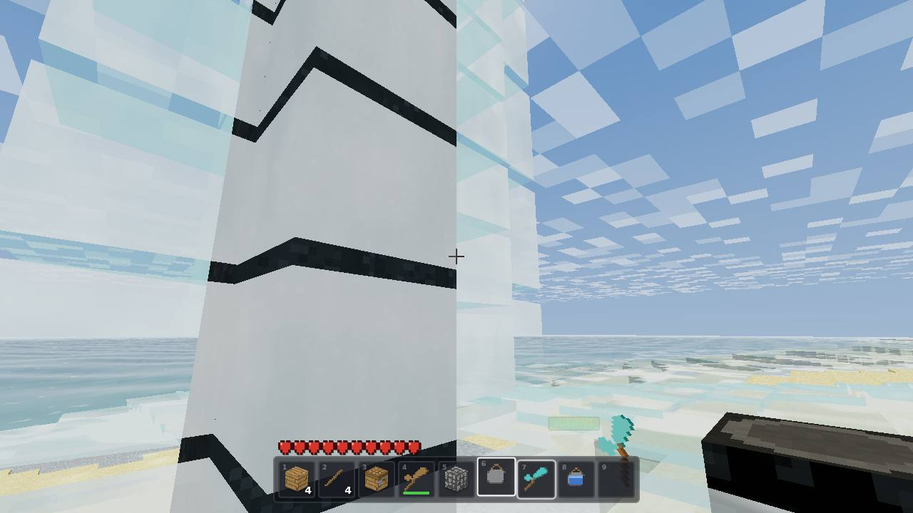
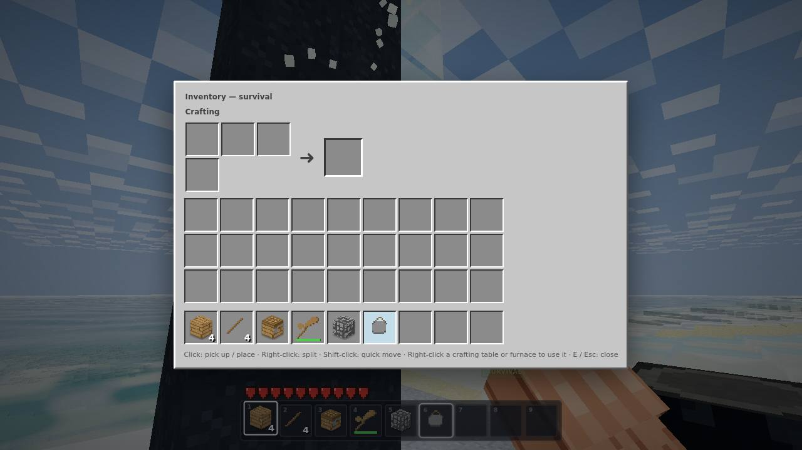
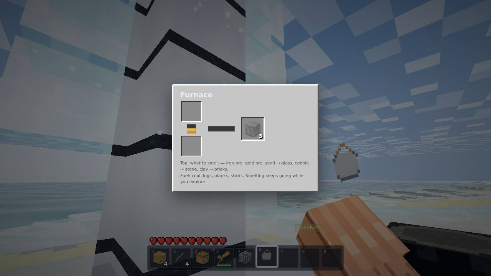
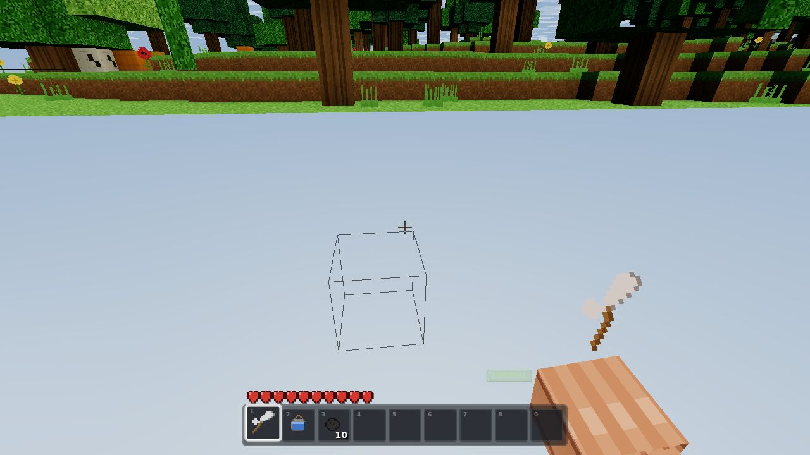
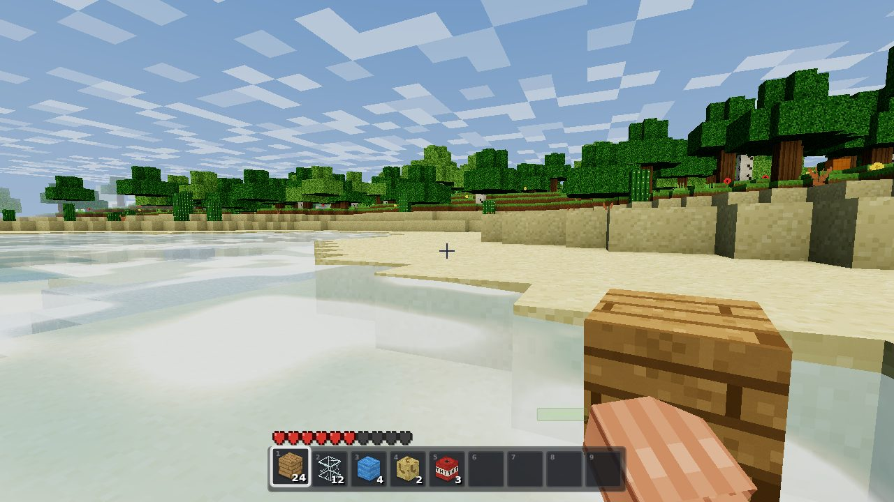
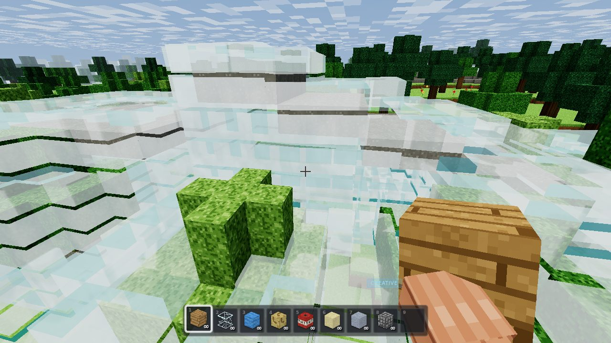
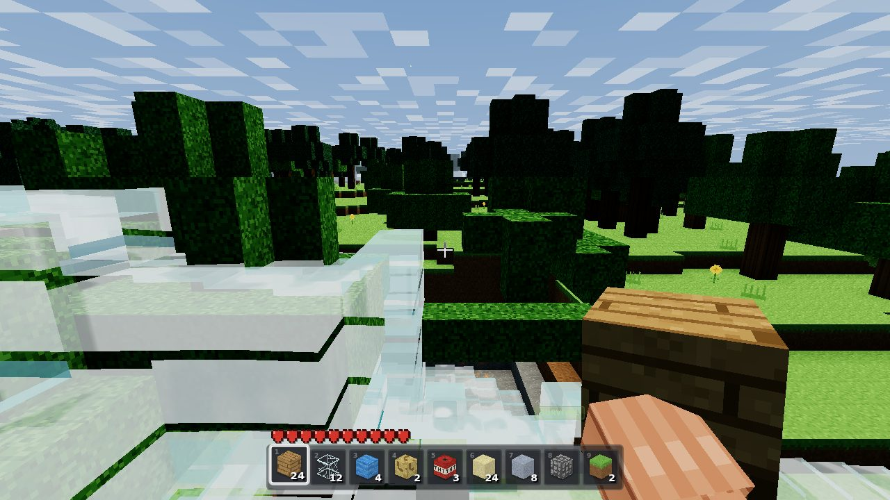

# VoxelCraft

A Minecraft-style voxel sandbox that lives in **one HTML file**. Open `index.html` (or the GitHub Pages link below) and you're standing on an island with **flowing water**, a day/night cycle, a full **survival mode** with hearts and drowning, **crafting** (2×2 pocket grid + 3×3 crafting table), **furnaces** that smelt while you explore, **tools** with tiers and durability, a **bucket** for moving water sources, **TNT**, **falling sand**, ores, 55+ blocks, timed block mining, a chunky lit first-person arm, a full inventory, and a world that saves itself to your browser.

**▶ Play it:** <https://ddown325.github.io/voxelcraft/>

## What's new in v5 — crafting, smelting, tools & the water overhaul

### Crafting, the Minecraft way
- **Punch a tree → planks → sticks → crafting table → wooden pickaxe.** The full progression is real now: survival starts empty-handed and every tool is earned.
- **2×2 pocket crafting** in your inventory (E) and the **full 3×3 grid when you right-click a crafting table** — same recipes, same matcher, trimmed grids so shape position doesn't matter (axes accept mirrored layouts too).
- **30 recipes**: planks (per wood species), sticks, crafting table, furnace, stone bricks, sandstone, bookshelf, TNT (5 coal + 4 sand), bucket, and **12 tools** — pickaxes, axes and shovels in wood/stone/iron/diamond.
- Click the result slot to take a craft (cursor stack, like MC); **shift-click to craft the whole batch**.

### Tools that matter
- **The right tool is 2.5–10× faster**: pickaxes chew stone-family blocks, axes fell trees, shovels move dirt/sand/gravel/snow.
- **Stone-family blocks need a pickaxe to drop anything** — mine stone bare-handed and you get nothing (the classic rule). Iron ore needs a stone pick; gold, diamond and obsidian need iron.
- **Durability**: every tool carries a wear bar under its icon (green → yellow → red), snaps with a toast when it's spent, and tools never stack — each is its own worn instance. Ores drop **items** now (coal, diamond), iron/gold ore smelts into **ingots**.
- Tools render **in your hand** as angled pixel-art sprites, lit by the same day/night rig as the arm.

### Furnaces
- Craft one from **8 cobblestone**, right-click to open: **input / fuel / output** slots with a live **flame gauge and cook bar**.
- Smelts **iron & gold ore → ingots, sand → glass, cobble → stone, clay → bricks**. Fuels: coal (8 items), logs/planks/crafting tables (1.5), sticks & dead bushes (0.5).
- **Smelting continues while you explore** — furnaces tick per block in the world, and their full state (charge, fuel, burn) persists in the save. Break a furnace and everything inside drops back to you.

### Bucket — water you can carry
- **3 iron ingots → bucket.** Right-click a still water source to **scoop** it, right-click anywhere to **pour** a fresh source — floods, repairs and irrigation without the palette. Creative buckets are infinite. (Both buckets also live in the creative palette.)

### Water: different fill states going up/down vs across
- Water now has a dedicated **falling fill state**: anything pouring downward renders and behaves as a **full-height sheet** (Minecraft's "falling" bit), while water spreading **across** ground keeps its **8 thinning levels**.
- **Falling resets the spread distance**: a waterfall landing re-spreads 7 blocks from where it touches down, exactly like MC. The notch under every pour is gone — falling columns are solid, land, and spread from the landing cell.
- Landing water on a lake no longer tears or oscillates — the falling cell stays falling while fed from above, and the splash ring crystallises into sources via the infinite-pool rule.
- Falls pour **one cell per tick** (watchable growth), never spread sideways mid-air (waterfalls stay narrow), and dry up top-down when their source goes.

### No more floating leaves
- **Trees only spawn where the surface is grass** — the generator used to grow canopies over sand/stone where the trunk check failed, leaving leaf blobs hovering on mountainsides.
- **Leaf decay**: chop the trunk out and the canopy **ages, pops and cascades away** (leaf survives only within 4 blocks of a log), with leaf-litter particles and sound. Touched-off automatically by mining, TNT and explosions.

### Survival, rebalanced for crafting
The old starter kit is gone — survival starts with **nothing but your fists**, the way it should be. Hearts, air, drowning, falls, cactus, TNT and the void still hurt; you still regenerate out of danger.

## What was new in v4 — survival, damage & 30 blocks

### Survival mode, for real *(v4)*
- **Hearts and air**: 10 hearts (20 HP) and a 10-bubble air meter above the hotbar. **Fall damage**, **drowning** when your air runs out, **cactus pricks**, **TNT blasts** and **the void** all hurt. You **regenerate** slowly when out of danger for 6 seconds.
- **Death screen** — "YOU DIED" with the cause, a Respawn button (back at spawn, full health) and Title Screen. Damage flashes a red vignette and jolts the hearts.
- Survival is **earned**: the creative palette is hidden, flight is disabled, mining takes time and every placed block is consumed. A small starter kit (planks, glass, water, sponge, TNT) gets you building. Switch to creative any time with **V**.

### 30 new blocks & three new block systems *(v4)*
- **Ores generate underground**: coal, iron, gold and diamond in 2×2×2 veins (diamonds deepest, y ≤ 12), plus a proper rugged **bedrock** floor that's unbreakable.
- **Falling sand & gravel**: unsupported sand becomes a falling entity, splashes down through water, and settles on the ground — mine carefully underneath.
- **TNT**: mine it in survival to light the fuse — it flashes, swells, then **explodes** a ~3.6-block crater with a flash + smoke column, a boom, camera shake and knockback. **Chain reactions** detonate neighbours; obsidian and bedrock resist; water absorbs the blast.
- New blocks: coal/iron/gold/diamond ore, bedrock, stone bricks, mossy cobblestone, sandstone, obsidian, ice (**slippery!**), clay, glowstone, **birch** & **spruce** logs/leaves/planks (spruce forests claim the high ground), 7 wool colours, cactus (**pricks!**), dead bush, pumpkin, bookshelf and TNT — all with procedural pixel-art textures.

### Water: gaps and mixing fixed for good *(v4)*
- **No more texture gaps in the water.** Wave amplitude is now driven by a **corner-averaged level** — two neighbouring cells compute *identical* values at their shared corners, so the displaced surface is continuous across every cell and chunk border. Verified seam-free.
- **No more water mixing/tearing.** Vertex wave phases are now a pure function of world position and time — the old per-cell flow advection desynced phases at shared corners and slowly tore the surface open. The visible current (advected ripples, directional foam streaks, churn on falls) lives on in the fragment stage, where it can't open gaps.

### A properly chunky arm *(v4)*
The arm is now genuinely **Steve-thick** — the forearm and fist boxes roughly doubled in cross-section, with a wider knuckle face, in the classic bottom-right pose with swing, sway, bob and place-recoil. No more skinny stick.

### Better inventory icons *(v4)*
The true-3D icon baker now renders at 144 px with a roomier classic angle and a **soft contact shadow** composited under each block — icons read as solid objects sitting in the slot, not flat stickers.

### Movement: jump like a miner *(v4)*
- **No auto step-up**: walking into a full block now stops you — **you must jump** (that's the point of stairs!). Swimming still lets you climb out onto the bank with a surface kick.
- **Sneak** is a careful slow walk; **ice** has almost no grip, so momentum carries you.

### Bigger render distance *(v4)*
The slider now runs **4–28 chunks** (default 10) with the same budgeted worker streaming.

## What was new in v3 — water that stops

### Water that actually stops (and knows why)
Three "flow forever" bugs are dead, each verified by a regression test:

- **No more runaway floods**: a splash landing on a lake used to regenerate full-height water over *every* surface cell, crawling across the entire ocean forever. Surface flow now **decays one level per block over water** like Minecraft — a waterfall pouring into the sea leaves a bounded ripple ring and settles.
- **No more floating sources**: flowing water flanked by two sources used to crystallise into a permanent source even while hovering over a void, seeding endless mid-air waterfalls. Source creation now requires solid ground (or a source) below — the real Minecraft rule.
- **No more re-flow on chunk reload**: streaming a chunk back in used to re-schedule every historical edit, making water visibly churn forever as you walked around. Only cells that are water or touch water re-settle now — plus a queue safety valve caps even a pathological flood.

### Water that reads as flowing
- Every water vertex now carries a **flow vector** (direction + speed) derived from the level gradient at mesh time. The shader **advects its ripples downstream** — waves visibly travel with the current instead of sliding across it.
- Rivers and spill-sheets show **directional current streaks** — elongated foam lines aligned with the flow, sliding at the water's own pace.
- Waterfalls render as **dense, near-opaque churning water**: fine vertical streaks up close, big slow white tongues that stay readable from far away, churn flags on every cell in a column, and a hard outward **splash-ring current** where the fall lands.
- Fixed inverted face winding on two of the four water side planes — waterfalls used to render as flat glass slabs through the back-face path.

### A proper chunky arm *(v3)*
The skinny stick is gone. The view model is now a **blocky forearm + wider fist** with knuckles, finger creases and a thumb wrap painted into the atlas, shaded per-face like terrain, in the classic bottom-right Minecraft pose. Bare fist and held-block poses are both tuned, and the dynamic lighting (day/night, sun warmth, underwater tint, mining flash) carries over.

### True 3D inventory icons *(v3)*
Every item icon is now an **actual 3D render**: an offscreen WebGL pass snapshots each block with the game's own atlas and face shading — identical to how the held block looks — instead of a skewed 2D sketch. (Falls back to the old 2D icons if a second GL context can't be created.)

### Huge render distance *(v3)*
- Worker pool scales with your CPU (up to 6), mesh uploads run on a **per-frame time budget**, the streaming scan only runs when you cross a chunk boundary, and far chunks **free their GPU meshes** while keeping voxel data — heap stays flat even at big distances.

## What was new in v2 — the water update

### Flowing water, for real
Water is a **fluid simulation**, not a static plane:

- **8 flow levels** stored per voxel (source + 7 decaying levels). Water spreads one level weaker per block, so a stream thins as it travels and stops after 7 blocks — exactly like Minecraft.
- **Waterfalls**: water prefers falling. A cell with air below pours down one cell per tick, building cascades you can watch grow — with mist and bubbles kicking up where it lands.
- **Cliff rule**: a stream that reaches an edge pours off it as a full falling column (mountain springs work).
- **Infinite pools**: flank a gap with two sources (on solid ground) and it crystallises into a new source — build classic infinite wells.
- **Draining**: remove the source (or soak it up) and the flood drains away level-by-level, waterfalls collapsing top-down.
- **Sponge**: place it to soak up every water cell in a 5×5×5 cube — the way to un-flood a build.
- **Placeable water**: water and sponge live in the block palette (E), so flowing-water play needs no grind.
- Thin flowing water renders flatter waves and streaky rapids foam; falling columns render full-height with a deep-blue body. Swimming, diving, raycasting and spawning all understand every flow level.

### First-person arm with real lighting
A proper Steve-style arm (procedural skin + sleeve texture) holds the view:

- Sleeve enters from the bottom-right, fist reaches toward centre — the classic pose, with the held block riding at the fist.
- **The arm is lit by the world**: bright at noon, dim at midnight, warm in direct sun, blue-tinted underwater, and it flashes on mining impact. The tint is driven by the same lighting rig as the terrain.
- Look **sway** (the arm lags a touch behind camera rotation), walk bob, swing arcs, and place-recoil.

## Features

### Crafting, smelting & tools
- **2×2 pocket grid** in the inventory, **3×3 at crafting tables** (right-click), shaped recipes with trimming + mirroring, dynamic outputs (any log → its own planks), shift-click batch crafting.
- **Furnaces** are per-block world state: input/fuel/output slots, flame + cook bars, fuels with different burn values, and full persistence.
- **Tool tiers** (wood/stone/iron/diamond) with mining speed, drop gating and durability; item stacks never merge tools; worn bars on every slot icon.
- **Items** as first-class inventory citizens: sticks, coal, ingots, diamonds, buckets — 16×16 procedural pixel-art sprites used for icons and the held-item view model.

### Water, first-class
Every water surface is a single custom shader — no cubemaps, no render targets, no post-processing:

- **Three directional wave trains** (sum of sines) displace the surface and yield an analytic normal per-vertex, plus a wave-height varying for subsurface glow. Flowing water scales its waves down to a thin film, and the wave phases **ride the flow vector** so ripples travel downstream. **Falling water keeps full-height waves** — the going-down fill state.
- **Schlick fresnel** blends the body colour into an analytic sky reflection computed along the reflected ray.
- **Depth-graduated body colour** — turquoise shallows fading to deep blue — driven by a per-vertex water-column depth attribute baked at mesh time.
- **Blinn-Phong sun glitter** that widens at low sun angles, micro-glints riding a scrolling ripple-noise field, and animated **shore foam** banded by noise near shallow columns.
- **Flow-directional current streaks** on moving water, **churn + white tongues** on falls, and splash-ring churn where falls land.
- **The underside is a first-class citizen**: looking up from below you see a brighter, transmissive surface with the sun still glittering through the waves.
- **Underwater atmosphere** — dense teal fog, animated caustics projected onto submerged geometry (terrain shader), rising bubble particles, a low-pass audio filter, and a screen-space tint.
- Sound design to match: waves lap louder near shore, swimming gets its own loop, splashes burst on entry.

### A real break system
- Hold left-click to mine: blocks have **per-type hardness** (÷ tool speed), a **10-stage crack overlay** grows on the targeted block, debris puffs kick up while you work, and the block pops with a burst of particles and a synthesized dig sound.
- Broken blocks **drop into your inventory** (stone drops cobblestone, ores drop items) — unless the pickaxe tier is too low, in which case they drop nothing, like the original.
- Every break **wears your tool one point**; a spent tool snaps and vanishes with a warning.

### Inventory
- 9-slot hotbar (keys 1–9 / scroll wheel) + 27-slot storage opened with **E**, plus the crafting grid and result slot.
- Pick up / place / swap / merge stacks, right-click to split, shift-click to quick-move; tools swap whole and never merge.
- **Creative mode** (V): instant break, infinite stacks, flight (F / double-space), and the palette with every block **plus items** — buckets, tools, materials. Survival hides the palette: mine and craft what you place.

### Saves
The whole world persists to `localStorage` — blocks you placed or broke (including every flow level and falling-water state), **furnace charges, tool durability**, player position, look, inventory, time of day and mode all round-trip. Blocks are stored as a **sparse diff against the generated terrain** and re-applied the instant a chunk regenerates, at which point the fluid sim re-settles around them. Autosave every 20 s, on pause, and on tab close.

### Performance
- Terrain generation, face culling, vertex AO and water meshing (including the flow field) all run in **Web Workers** (Blob-based, zero bundler config), transferring buffers zero-copy.
- Worker pool scales with the CPU (3–6 workers); chunks stream in a distance-sorted queue and mesh uploads run on a **per-frame time budget**; the streaming scan only fires when you cross a chunk boundary.
- Far chunks **free their GPU meshes** while keeping voxel data until they fully unload — flat memory at huge render distances.
- The fluid sim processes at most 96 cells per 0.2 s tick, and only cells whose neighbourhood changed — a settled ocean costs zero work per frame, with a hard queue cap as a runaway-flood safety valve.
- One draw call per chunk per pass (opaque / foliage / water). Distance fog hides the streaming edge.
- Seeded, deterministic worldgen and gameplay randomness (no `Math.random` in gameplay paths).

### The rest
Day/night cycle with sunrise palettes, stars and a moon; drifting blocky clouds; vertex-AO terrain with wrapped sun lighting; swaying grass and flowers; procedural 16×16 texture atlas (arm, fist, sponge and water tiles included), true-3D inventory icons, crack decals and cloud texture — all painted in code; fully synthesized Web Audio (wind, waves, footsteps, digs, UI); pointer-lock first-person controller with sprint, sneak, swim and flight.

## Controls

| Key | Action |
| --- | --- |
| `W A S D` | Move |
| Mouse | Look |
| Left click (hold) | Mine — cracks show progress |
| Right click | Place block · **use crafting tables & furnaces** · **scoop/pour buckets** |
| Middle click | Pick block |
| `1`–`9` / wheel | Hotbar |
| `E` | Inventory + pocket crafting (2×2) |
| `Space` | Jump — you must jump up full blocks · swim up · double-tap to fly (creative) |
| `Shift` | Sneak / descend · right-click through tables/furnaces to place against them |
| `Ctrl` | Sprint |
| `V` | Toggle creative mode |
| `F` | Toggle flight (creative only) |
| `F3` | Debug overlay |
| `Esc` | Pause |

## Tech

- [Three.js](https://threejs.org/) r160 (only dependency, via CDN + import map)
- Vanilla ES modules, zero build step
- Web Workers for chunk generation & meshing
- Custom GLSL for water, sky and terrain lighting
- 0.2 s fixed-tick fluid simulation on the main thread
- `localStorage` persistence

## Run it

No build, no install — open `index.html` in any modern desktop browser, or serve it statically (this is exactly what GitHub Pages does). Works from `file://` too.

## Screenshots

| | |
| --- | --- |
|  |  |
|  |  |
|  |  |
|  |  |
|  |  |

## License

MIT — see [LICENSE](LICENSE).
