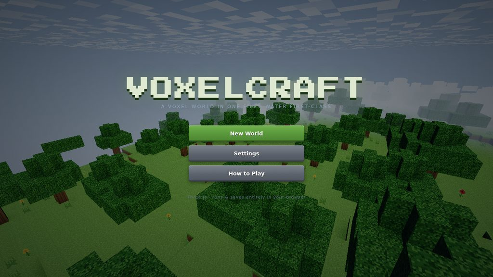

# VoxelCraft

A Minecraft-style voxel sandbox that lives in **one HTML file**. Open `index.html` (or the GitHub Pages link below) and you're standing on an island with shader-driven water, a day/night cycle, timed block mining, a full inventory, and a world that saves itself to your browser.

**▶ Play it:** <https://ddown325.github.io/voxelcraft/>

## Features

### Water, first-class
Every water surface is a single custom shader — no cubemaps, no render targets, no post-processing:

- **Three directional wave trains** (sum of sines) displace the surface and yield an analytic normal per-vertex, plus a wave-height varying for subsurface glow.
- **Schlick fresnel** blends the body colour into an analytic sky reflection computed along the reflected ray.
- **Depth-graduated body colour** — turquoise shallows fading to deep blue — driven by a per-vertex water-column depth attribute baked at mesh time.
- **Blinn-Phong sun glitter** that widens at low sun angles, micro-glints riding a scrolling ripple-noise field, and animated **shore foam** banded by noise near shallow columns.
- **The underside is a first-class citizen**: looking up from below you see a brighter, transmissive surface with the sun still glittering through the waves.
- **Underwater atmosphere** — dense teal fog, animated caustics projected onto submerged geometry (terrain shader), a low-pass audio filter, and a screen-space tint.
- Sound design to match: waves lap louder near shore, swimming gets its own loop, splashes burst on entry.

### A real break system
- Hold left-click to mine: blocks have **per-type hardness**, a **10-stage crack overlay** grows on the targeted block, debris puffs kick up while you work, and the block pops with a burst of particles and a synthesized dig sound.
- Broken blocks **drop into your inventory** (stone drops cobblestone, like the original).

### Inventory
- 9-slot hotbar (keys 1–9 / scroll wheel) + 27-slot storage opened with **E**.
- Pick up / place / swap / merge stacks, right-click to split, shift-click to quick-move.
- **Creative mode** (V): instant break, infinite stacks and a palette of every block.

### Saves
The whole world persists to `localStorage` — blocks you placed or broke are stored as a **sparse diff against the generated terrain** and re-applied the instant a chunk regenerates. Player position, look, inventory, time of day and mode all round-trip. Autosave every 20 s, on pause, and on tab close.

### Performance
- Terrain generation, face culling, vertex AO and water-depth attribution all run in **Web Workers** (Blob-based, zero bundler config), transferring buffers zero-copy.
- Chunks stream in a distance-sorted queue; mesh uploads are frame-budgeted; far chunks unload and dispose.
- One draw call per chunk per pass (opaque / foliage / water). Distance fog hides the streaming edge.
- Seeded, deterministic worldgen and gameplay randomness (no `Math.random` in gameplay paths).

### The rest
Day/night cycle with sunrise palettes, stars and a moon; drifting blocky clouds; vertex-AO terrain with wrapped sun lighting; swaying grass and flowers; procedural 16×16 texture atlas, isometric inventory icons, crack decals and cloud texture — all painted in code; fully synthesized Web Audio (wind, waves, footsteps, digs, UI); pointer-lock first-person controller with sprint, sneak, swim and flight.

## Controls

| Key | Action |
| --- | --- |
| `W A S D` | Move |
| Mouse | Look |
| Left click (hold) | Mine — cracks show progress |
| Right click | Place selected block |
| Middle click | Pick block |
| `1`–`9` / wheel | Hotbar |
| `E` | Inventory |
| `Space` | Jump / swim up · double-tap to fly |
| `Shift` | Sneak / descend |
| `Ctrl` | Sprint |
| `V` | Toggle creative mode |
| `F3` | Debug overlay |
| `Esc` | Pause |

## Tech

- [Three.js](https://threejs.org/) r160 (only dependency, via CDN + import map)
- Vanilla ES modules, zero build step
- Web Workers for chunk generation & meshing
- Custom GLSL for water, sky and terrain lighting
- `localStorage` persistence

## Run it

No build, no install — open `index.html` in any modern desktop browser, or serve it statically (this is exactly what GitHub Pages does). Works from `file://` too.

## Screenshots

| | |
| --- | --- |
|  |  |
|  |  |

## License

MIT — see [LICENSE](LICENSE).
