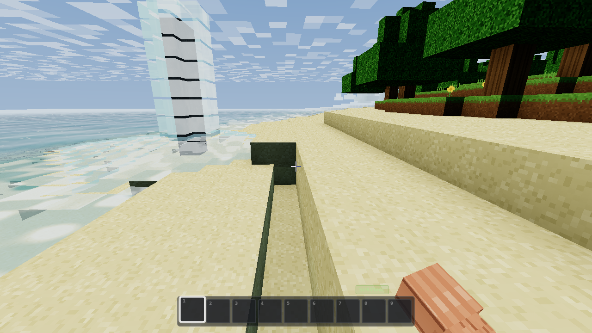
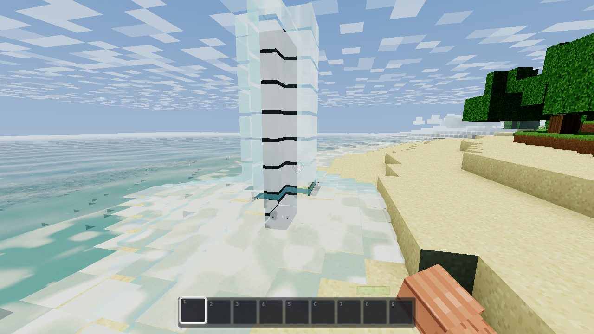
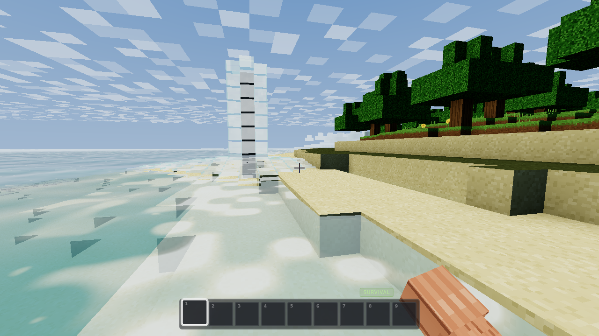
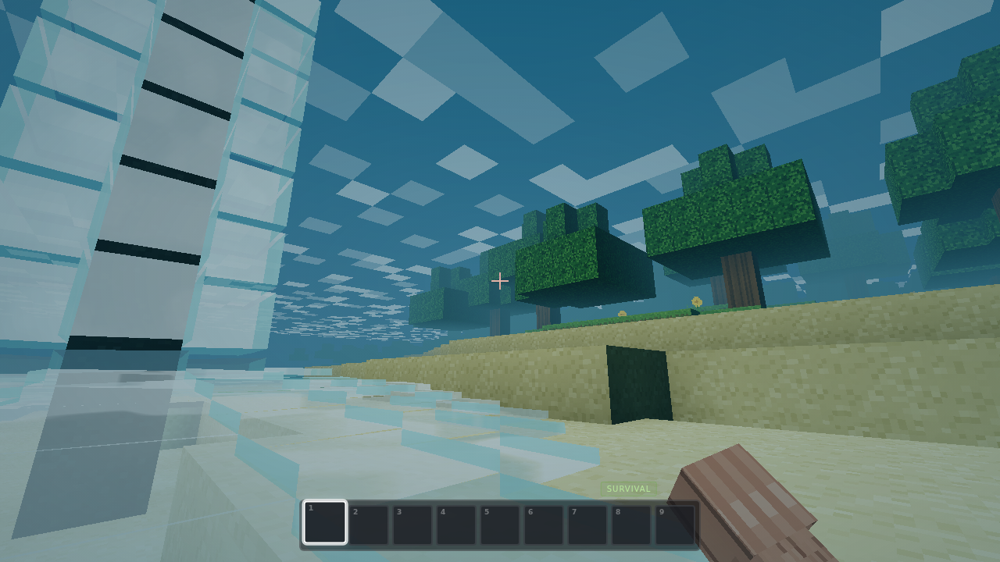
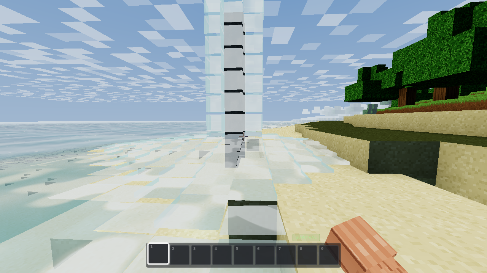
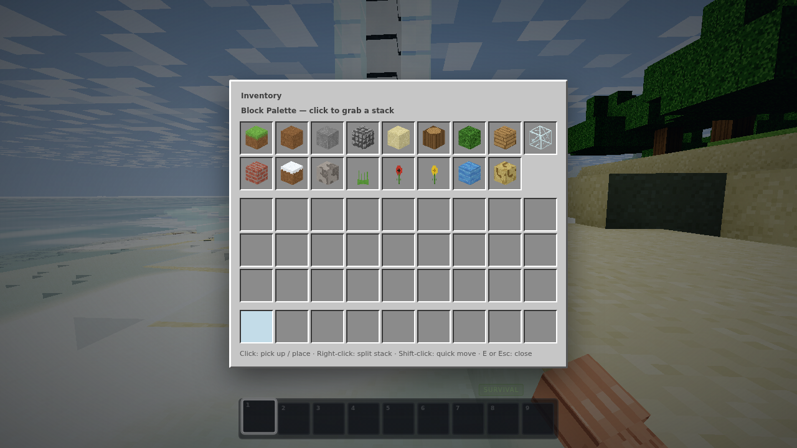

# VoxelCraft

A Minecraft-style voxel sandbox that lives in **one HTML file**. Open `index.html` (or the GitHub Pages link below) and you're standing on an island with **flowing water**, a day/night cycle, timed block mining, a lit first-person arm, a full inventory, and a world that saves itself to your browser.

**▶ Play it:** <https://ddown325.github.io/voxelcraft/>

## What's new in v3 — the current update

### Water that actually stops (and knows why)
Three "flow forever" bugs are dead, each verified by a regression test:

- **No more runaway floods**: a splash landing on a lake used to regenerate full-height water over *every* surface cell, crawling across the entire ocean forever. Surface flow now **decays one level per block over water** like Minecraft — a waterfall pouring into the sea leaves a bounded ripple ring and settles.
- **No more floating sources**: flowing water flanked by two sources used to crystallise into a permanent source even while hovering over a void, seeding endless mid-air waterfalls. Source creation now requires solid ground (or a source) below — the real Minecraft rule.
- **No more re-flow on chunk reload**: streaming a chunk back in used to re-schedule every historical edit, making water visibly churn forever as you walked around. Only cells that are water or touch water re-settle now — plus a queue safety valve caps even a pathological flood.

### Water that reads as flowing
- Every water vertex now carries a **flow vector** (direction + speed) derived from the level gradient at mesh time. The shader **advects its ripples downstream** — waves visibly travel with the current instead of sliding across it.
- Rivers and spill-sheets show **directional current streaks** — elongated foam lines aligned with the flow, sliding at the water's own pace.
- Waterfalls render as **dense, near-opaque churning water**: fine vertical streaks up close, big slow white tongues that stay readable from far away, churn flags on every cell in a column, and a hard outward **splash-ring current** where the fall lands.
- Fixed inverted face winding on two of the four water side planes — waterfalls used to render as flat glass slabs through the back-face path.

### A proper chunky arm
The skinny stick is gone. The view model is now a **blocky forearm + wider fist** with knuckles, finger creases and a thumb wrap painted into the atlas, shaded per-face like terrain, in the classic bottom-right Minecraft pose. Bare fist and held-block poses are both tuned, and the dynamic lighting (day/night, sun warmth, underwater tint, mining flash) carries over.

### True 3D inventory icons
Every item icon is now an **actual 3D render**: an offscreen WebGL pass snapshots each block with the game's own atlas and face shading — identical to how the held block looks — instead of a skewed 2D sketch. (Falls back to the old 2D icons if a second GL context can't be created.)

### Huge render distance
- The slider now runs **4–20 chunks** (presets 4 / 8 / 12), with adaptive fog.
- Worker pool scales with your CPU (up to 6), mesh uploads run on a **per-frame time budget**, the streaming scan only runs when you cross a chunk boundary, and far chunks **free their GPU meshes** while keeping voxel data — heap stays flat at ~25 MB even at 20 chunks.

## What was new in v2 — the water update

### Flowing water, for real
Water is a **fluid simulation**, not a static plane:

- **8 flow levels** stored per voxel (source + 7 decaying levels). Water spreads one level weaker per block, so a stream thins as it travels and stops after 7 blocks — exactly like Minecraft.
- **Waterfalls**: water prefers falling. A cell with air below pours down one cell per tick, building cascades you can watch grow — with mist and bubbles kicking up where it lands.
- **Cliff rule**: a stream that reaches an edge pours off it as a full falling column (mountain springs work).
- **Infinite pools**: flank a gap with two sources (on solid ground) and it crystallises into a new source — build classic infinite wells.
- **Draining**: remove the source (or soak it up) and the flood drains away level-by-level, waterfalls collapsing top-down.
- **Sponge**: place it to soak up every water cell in a 5×5×5 cube — the way to un-flood a build.
- **Placeable water**: water and sponge live in the block palette (E), so flowing-water play needs no grind.
- Thin flowing water renders flatter waves and streaky rapids foam; falling columns render full-height with a deep-blue body. Swimming, diving, raycasting and spawning all understand every flow level.

### First-person arm with real lighting
A proper Steve-style arm (procedural skin + sleeve texture) holds the view:

- Sleeve enters from the bottom-right, fist reaches toward centre — the classic pose, with the held block riding at the fist.
- **The arm is lit by the world**: bright at noon, dim at midnight, warm in direct sun, blue-tinted underwater, and it flashes on mining impact. The tint is driven by the same lighting rig as the terrain.
- Look **sway** (the arm lags a touch behind camera rotation), walk bob, swing arcs, and place-recoil.

## Features

### Water, first-class
Every water surface is a single custom shader — no cubemaps, no render targets, no post-processing:

- **Three directional wave trains** (sum of sines) displace the surface and yield an analytic normal per-vertex, plus a wave-height varying for subsurface glow. Flowing water scales its waves down to a thin film, and the wave phases **ride the flow vector** so ripples travel downstream.
- **Schlick fresnel** blends the body colour into an analytic sky reflection computed along the reflected ray.
- **Depth-graduated body colour** — turquoise shallows fading to deep blue — driven by a per-vertex water-column depth attribute baked at mesh time.
- **Blinn-Phong sun glitter** that widens at low sun angles, micro-glints riding a scrolling ripple-noise field, and animated **shore foam** banded by noise near shallow columns.
- **Flow-directional current streaks** on moving water, **churn + white tongues** on falls, and splash-ring churn where falls land.
- **The underside is a first-class citizen**: looking up from below you see a brighter, transmissive surface with the sun still glittering through the waves.
- **Underwater atmosphere** — dense teal fog, animated caustics projected onto submerged geometry (terrain shader), rising bubble particles, a low-pass audio filter, and a screen-space tint.
- Sound design to match: waves lap louder near shore, swimming gets its own loop, splashes burst on entry.

### A real break system
- Hold left-click to mine: blocks have **per-type hardness**, a **10-stage crack overlay** grows on the targeted block, debris puffs kick up while you work, and the block pops with a burst of particles and a synthesized dig sound.
- Broken blocks **drop into your inventory** (stone drops cobblestone, like the original).

### Inventory
- 9-slot hotbar (keys 1–9 / scroll wheel) + 27-slot storage opened with **E**.
- Pick up / place / swap / merge stacks, right-click to split, shift-click to quick-move.
- **Creative mode** (V): instant break, infinite stacks. The palette includes every block — plus water and sponge.

### Saves
The whole world persists to `localStorage` — blocks you placed or broke (including every flow level) are stored as a **sparse diff against the generated terrain** and re-applied the instant a chunk regenerates, at which point the fluid sim re-settles around them. Player position, look, inventory, time of day and mode all round-trip. Autosave every 20 s, on pause, and on tab close.

### Performance
- Terrain generation, face culling, vertex AO and water meshing (including the flow field) all run in **Web Workers** (Blob-based, zero bundler config), transferring buffers zero-copy.
- Worker pool scales with the CPU (3–6 workers); chunks stream in a distance-sorted queue and mesh uploads run on a **per-frame time budget**; the streaming scan only fires when you cross a chunk boundary.
- Far chunks **free their GPU meshes** while keeping voxel data until they fully unload — flat memory at huge render distances.
- The fluid sim processes at most 96 cells per 0.2 s tick, and only cells whose neighbourhood changed — a settled ocean costs zero work per frame, with a hard queue cap as a runaway-flood safety valve.
- One draw call per chunk per pass (opaque / foliage / water). Distance fog hides the streaming edge.
- Seeded, deterministic worldgen and gameplay randomness (no `Math.random` in gameplay paths).

### The rest
Day/night cycle with sunrise palettes, stars and a moon; drifting blocky clouds; vertex-AO terrain with wrapped sun lighting; swaying grass and flowers; procedural 16×16 texture atlas (arm, fist, sponge and water tiles included), true-3D inventory icons, crack decals and cloud texture — all painted in code; fully synthesized Web Audio (wind, waves, footsteps, digs, UI); pointer-lock first-person controller with sprint, sneak, swim and flight.

## Controls

| Key | Action |
| --- | --- |
| `W A S D` | Move |
| Mouse | Look |
| Left click (hold) | Mine — cracks show progress |
| Right click | Place selected block |
| Middle click | Pick block |
| `1`–`9` / wheel | Hotbar |
| `E` | Inventory |
| `Space` | Jump / swim up · double-tap to fly |
| `Shift` | Sneak / descend |
| `Ctrl` | Sprint |
| `V` | Toggle creative mode |
| `F3` | Debug overlay |
| `Esc` | Pause |

## Tech

- [Three.js](https://threejs.org/) r160 (only dependency, via CDN + import map)
- Vanilla ES modules, zero build step
- Web Workers for chunk generation & meshing
- Custom GLSL for water, sky and terrain lighting
- 0.2 s fixed-tick fluid simulation on the main thread
- `localStorage` persistence

## Run it

No build, no install — open `index.html` in any modern desktop browser, or serve it statically (this is exactly what GitHub Pages does). Works from `file://` too.

## Screenshots

| | |
| --- | --- |
|  |  |
|  |  |
|  |  |

## License

MIT — see [LICENSE](LICENSE).
